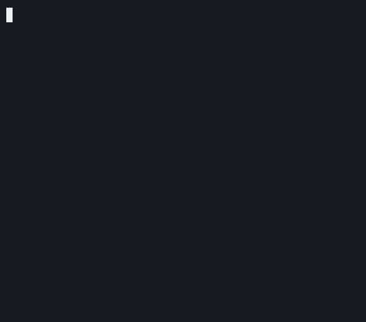

# Maze: the head decides when to play it safe

**English** · [Русский](README.md)

Our own Pac-Man-style arcade: ghosts chase the hero, dots are collected, power pellets give a few seconds of safety. The `need_deep` head predicts that a greedy step toward a dot will end in losing a life, and only then switches on a cautious route around the ghosts.



*14 seconds of a real recording (seed 3): 1840 points, two deaths, 28% escalations, the level cleared.*

## Why this is here

Unlike chess, the decision here is made **in real time and under risk**: eat a dot next to a ghost or go around. This is exactly the task the project has a calibrated `Noul` and a cascade for.

The roles are separated honestly:

| Who | What it does |
| --- | --- |
| greedy policy | BFS to the nearest dot, ghosts ignored — cheap and deadly |
| bonus | once every 70 steps a bonus appears on the map for 45 steps: 100 points if you get there in time |
| cautious policy | the same BFS, but cells next to ghosts cost more — about 10× more work |
| the `need_deep` head | predicts that a greedy step will kill within the next 12 moves |
| the cascade | escalates to the cautious route only on its signal |

## Installation

The game needs nothing beyond the project itself. Recording a GIF needs the binaries:

```bash
# https://github.com/asciinema/asciinema/releases
# https://github.com/asciinema/agg/releases
```

## The full loop

```bash
# 1. data: 80 games with a mixed policy, the label is whether the hero dies
#    within 12 moves after a greedy step (~2800 positions, a minute)
.venv/bin/python -m examples.games.maze.dataset --out data/maze/maze.jsonl

# 2. the head: the standard train_benchmark and temperature gate
.venv/bin/python -m examples.games.maze.train \
  --data data/maze/maze.jsonl --out checkpoints/packs/maze --steps 800

# 3. evaluation: score, deaths and cost over 100 episodes
.venv/bin/python -m examples.games.maze.evaluate \
  --pack checkpoints/packs/maze --episodes 60

# 4. one game
.venv/bin/python -m examples.games.maze.play --pack checkpoints/packs/maze --seed 3

# 5. GIF recording
bash examples/games/maze/record.sh
```

## What counts as a metric

The label is not invented by a human: the world is run 12 steps forward with the greedy policy, and `need_deep = 1` if the hero loses a life during that time. This is exactly the event worth paying for a cautious route for, so training and evaluation use the same criterion.

| Metric (test, n=560) | Value |
| --- | ---: |
| Share of positions with `need_deep = 1` | 28% |
| Accuracy | 0.757 |
| Brier | 0.172 |
| ECE (10 bins) | **0.063** |

Accuracy here is barely different from the constant "always no" (0.72): the event is rare, and ghosts move with an element of randomness. So look at Brier and ECE — the `need_deep` probability behaves like a probability, and the threshold can be chosen by the cost of an error. Whether this works in practice is visible in the scores below.

## Cost against quality

100 episodes of 300 steps, 3 lives, one cell per tick and 30% random moves for the ghosts:

| Policy | Score | Deaths | Escalations | Work per move |
| --- | ---: | ---: | ---: | ---: |
| greedy | 829 | 2.79 | 0% | 4 |
| **cascade 0.3** | **1684** | 2.08 | 33% | **7** |
| cascade 0.4 | 1626 | 2.13 | 26% | 7 |
| cascade 0.5 | 1604 | 2.15 | 20% | 7 |
| cautious | 1795 | 1.76 | 100% | 9 |

The cascade collects **94% of the cautious policy's score** and twice as much as the greedy one, paying for the cautious route on every third move. The greedy policy dies almost three times per episode and loses half the points.

The threshold is a knob: higher (0.5) means fewer escalations and fewer points, lower (0.3) is closer to "always cautious". The default value of 0.3 was chosen from this table.

Work per move is the number of states examined (BFS nodes plus simulation steps). The difference between the policies here is modest: the grid is small and BFS over it is cheap. The main gain of the cascade is not in nodes but in the fact that **two thirds of the moves do not pay** for the cautious route.

## Limitations

- This is **not** reinforcement learning: the heads are linear, learn from outcome labels, and the policies are plain BFS. The head's task is narrow: predict death, not play.
- The environment is ours and deliberately simple: one map, three ghosts, speed 2. The numbers cannot be transferred to a real arcade — this is a demonstration of the decision contract.
- One seed per recording: the GIF shows one game, not a distribution. The numbers are in the table above, over 60 episodes.
